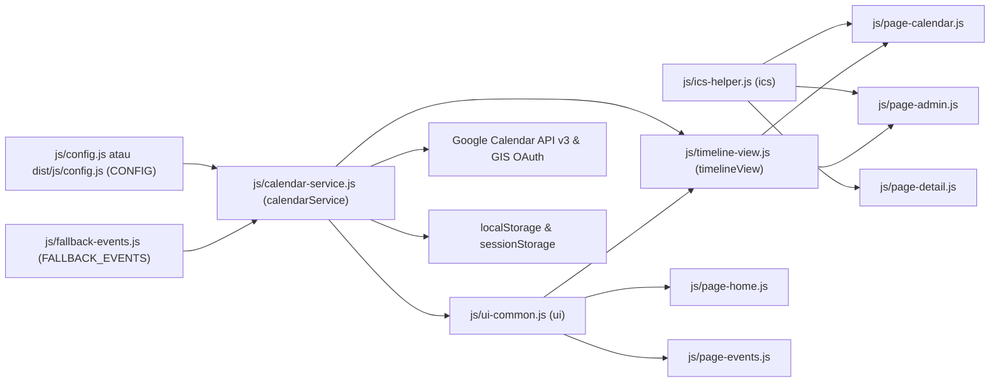

# Rekapitulasi Arsitektur & Logika Kode Portal Event Kampus

Dokumen ini merangkum peran dan cara kerja seluruh berkas pada proyek Portal Event Kampus (HTML5, CSS3, dan Vanilla JavaScript tanpa framework), dengan fokus utama pada modul logika di folder `js/`.

---

## 1. Gambaran Besar Alur Data & Namespace `window.PortalKampus`

Seluruh skrip dimuat melalui tag `<script defer>` tanpa bundler. Agar setiap file tetap terisolasi tetapi bisa saling berkomunikasi, setiap modul membungkus kodenya di dalam IIFE (`(function () { ... })()`) lalu mendaftarkan API publiknya ke objek global `window.PortalKampus`.

Urutan pemuatan skrip di HTML menentukan dependensi. File konfigurasi selalu dimuat lebih dulu, disusul data cadangan, utilitas kalender/ICS, layanan Google Calendar, utilitas UI bersama, lalu komponen halaman spesifik.

---

## 2. Lapisan JavaScript Inti (`js/`)

### A. Konfigurasi & Data Cadangan

#### [config.example.js](file:///d:/VSCode/WebDev/TR/VOL.%202.1/js/config.example.js) & `js/config.js`
Template publik (`config.example.js`, aman di GitHub) dan berkas konfigurasi lokal (`js/config.js`, di-ignore oleh Git) yang mendefinisikan objek `window.PortalKampus.CONFIG`:
- `googleCalendar`: menyimpan `calendarId`, `apiKey`, `oauthClientId`, `oauthSessionMinutes` (`30`), `timeZone` (`'Asia/Jakarta'`), `maxResults` (`100`), dan `cacheMinutes` (`5`).
- `adminAuth`: menyimpan `pinHash` (hash SHA-256 hex 64 karakter dari `ADMIN_PIN`) dan `sessionMinutes` (`30`). Di `config.example.js`, `pinHash` dibiarkan kosong dan disuntikkan otomatis saat build Vercel.
- `timeline`: batas jam kerja timeline (`startHour: 7`, `endHour: 22`, `hourHeightPx: 60`, `snapMinutes: 15`, `defaultDurationMinutes: 60`).
- `categories`: 6 kategori resmi (`seminar`, `lomba`, `workshop`, `seni`, `ukm`, `umum`) lengkap dengan label ID/EN serta `defaultPoster` dan `defaultPosterAlt`.
- `presetPosters`: daftar 18 foto kampus di `assets/img/` yang muncul pada galeri pemilih thumbnail di halaman Admin.
- `storageKeys`: nama kunci `localStorage` dan `sessionStorage` (`lang`, `eventsCache`, `adminDrafts`, `adminSession`, `adminPinSession`).
- `i18n`: kamus label singkat bahasa Indonesia (`id`) dan Inggris (`en`) untuk elemen yang dirender oleh JavaScript.

#### [fallback-events.js](file:///d:/VSCode/WebDev/TR/VOL.%202.1/js/fallback-events.js)
Menyediakan array `window.PortalKampus.FALLBACK_EVENTS` berisi data event contoh lokal. Digunakan otomatis oleh `calendar-service.js` saat Google Calendar API belum dikonfigurasi (`source: 'fallback'`) atau gagal diambil karena jaringan/API error (`source: 'fallback-error'`).

---

### B. Layanan Data, Autentikasi 30 Menit, & Keamanan URL

#### [calendar-service.js](file:///d:/VSCode/WebDev/TR/VOL.%202.1/js/calendar-service.js)
Bertindak sebagai pusat data, autentikasi admin, dan sanitasi input. Seluruh API diekspos ke `window.PortalKampus.calendarService`:

1. **Sanitasi & Parsing Google Calendar**:
   - `escapeHtml`: mengamankan teks dinamis sebelum masuk ke HTML agar terhindar dari XSS.
   - `sanitizeUrl`: hanya mengizinkan protokol `https:`, `http:`, `mailto:`, atau path lokal `assets/` maupun `event-*.html`.
   - `extractGoogleDriveFileId`, `isGoogleDriveUrl`, & `normalizePosterUrl`: mengekstrak ID berkas dari link share Google Drive (`/file/d/<id>` atau `?id=<id>`) lalu mengubahnya menjadi `https://drive.google.com/thumbnail?id=<id>&sz=w1200` agar dapat dimuat langsung oleh tag ``.
   - `stripHtmlTags`, `parseDescriptionTags`, & `parseRundownInline`: membaca deskripsi Google Calendar dan mengekstrak tag metadata seperti `Kategori:`, `Status:`, `Poster:`, `Daftar:`, `Biaya:`, `Kontak:`, dan daftar baris `Rundown:`.
   - `findImageAttachmentPoster`: memeriksa `item.attachments` dari Google Calendar API bila event memiliki lampiran gambar tanpa tag `Poster:`.
   - `resolveEventStatus`, `normalizeEventObject`, & `mapGoogleItemToEvent`: menyeragamkan format event (menghitung status otomatis `open`/`closed` berdasarkan waktu jika tidak ditulis manual, menyusun `dateKey`, dan memastikan fallback poster kategori selalu terisi).

2. **Pengambilan & Cache Jadwal Publik**:
   - `fetchGoogleEvents`: membaca cache dari `sessionStorage` (`cacheMinutes: 5`) lewat `readCachedGoogleEvents` bila `forceRefresh` tidak aktif. Jika cache kedaluwarsa, melakukan `fetch` ke endpoint Google Calendar API v3 (`singleEvents=true`, `orderBy=startTime`). Bila token OAuth admin valid, menyertakan header `Authorization: Bearer ...`.
   - `getEvents` & `getEventById`: memanggil `fetchGoogleEvents` jika terkonfigurasi, atau jatuh kembali ke `getFallbackEvents()` sambil mengembalikan penanda `source` (`'google'`, `'fallback'`, atau `'fallback-error'`).
   - `findOverlappingEvents`: mendeteksi bentrok jadwal antar-event bertipe jam (bukan `isAllDay`) pada rentang `startIso` sampai `endIso`.

3. **Gerbang PIN Admin & Sesi 30 Menit (`localStorage`)**:
   - `sha256Hex` & `sha256FallbackHex`: menghitung hash SHA-256 memakai Web Crypto API (`crypto.subtle`) pada konteks aman (`https://`, `127.0.0.1`, `localhost`), serta menyediakan implementasi SHA-256 JavaScript murni sebagai cadangan di luar secure context.
   - `verifyAdminPin`: membandingkan hash input terhadap `CONFIG.adminAuth.pinHash` (memakai perbandingan bit `xor` panjang tetap). Jika cocok, menyimpan sesi `{ verified, pinHash, loggedInAt, expiresAt }` ke `localStorage` untuk durasi `30` menit.
   - `loadAdminPinSession`, `hasValidAdminPinSession`, `getAdminPinStatus`, & `lockAdminPanel`: memulihkan status buka kunci antar-tab/refresh, otomatis membatalkan sesi jika `Date.now() >= expiresAt` atau jika hash PIN di konfigurasi berubah, serta mengunci panel saat admin menekan keluar.

4. **Google OAuth 2.0 & Operasi Tulis (CRUD)**:
   - `requestAdminToken`: menggunakan Google Identity Services (`initTokenClient`) untuk scope `https://www.googleapis.com/auth/calendar.events`. Membatasi masa simpan token lokal maksimal `30` menit (`Math.min(getSessionMinutes() * 60000, googleTtlMs - 15000)`) dan menyimpannya ke `localStorage` (`persistAdminSession`, `loadAdminSession`).
   - `mutateGoogleEvent`, `createGoogleEvent`, `updateGoogleEvent`, `deleteGoogleEvent`: mengirim permintaan `POST`, `PATCH`, atau `DELETE` ke Google Calendar API memakai token `Bearer`. Jika server mengembalikan `HTTP 401`, token di memori dan `localStorage` langsung dibersihkan, lalu cache `sessionStorage` dihapus (`clearCache`).

---

### C. Utilitas Ekspor Kalender & Antarmuka Bersama

#### [ics-helper.js](file:///d:/VSCode/WebDev/TR/VOL.%202.1/js/ics-helper.js)
Diekspos sebagai `window.PortalKampus.ics` untuk fitur kalender pengunjung dan fallback admin:
- `buildGoogleCalendarAddUrl`: menyusun link `https://calendar.google.com/calendar/render?action=TEMPLATE...` berisi judul, tanggal UTC (atau format tanggal `YYYYMMDD` untuk event sepanjang hari), lokasi, dan deskripsi lengkap.
- `buildGoogleCalendarSubscribeUrl`: menyusun URL langganan kalender publik berdasarkan `calendarId`.
- `buildIcsContent` & `downloadEventIcs`: merakit berkas berstandar RFC `BEGIN:VCALENDAR ... END:VCALENDAR` dengan escaping karakter khusus (`\`, `;`, `,`, baris baru) dan memicu unduhan `Blob` `.ics`.
- `buildWhatsAppShareUrl`: menyusun tautan `https://wa.me/?text=...` dengan ringkasan acara.

#### [ui-common.js](file:///d:/VSCode/WebDev/TR/VOL.%202.1/js/ui-common.js)
Diekspos sebagai `window.PortalKampus.ui` dan dimuat di semua halaman:
- **Bahasa (`ID` / `EN`)**: `getCurrentLang`, `t`, dan `applyStoredLanguage` menyinkronkan radio `#lang-ba` dan `#lang-en` dengan `localStorage`, mengatur atribut `<html lang>`, lalu memicu custom event `portal:langchange`.
- **Aksesibilitas Drawer Mobile**: `setupMobileDrawerAccessibility` mengelola `aria-expanded`, menutup menu lewat tombol `Escape`, serta menutup drawer saat tautan navigasi diklik.
- **Kartu Event & Fallback Gambar**: `renderEventCard` mencetak kartu acara yang seragam untuk Beranda, Daftar Event, dan Pratinjau Admin. `attachImageFallbacks` memasang listener `error` sekali pakai pada `img[data-fallback]` agar poster rusak otomatis beralih ke gambar default kategori.
- **Status & Banner Sumber Data**: `renderStatusState` merender tampilan loading/empty/error. `renderSourceNotice` otomatis mengosongkan dan menyembunyikan kontainer banner (`container.hidden = true`) ketika `source === 'google'`, dan hanya menampilkan tombol `Coba Muat Ulang` bila terjadi error atau mode fallback.
- **Tahan Logo 2 Detik (`setupLogoAdminHold`)**:
  - Menyisipkan `<svg class="brand-hold-ring">` dengan dua `<rect pathLength="100">` di sekeliling `.site-header .brand-mark`.
  - Menggunakan `requestAnimationFrame` untuk mengisi border dari `stroke-dashoffset: 100` menuju `0` selama `2000ms` saat mouse, sentuh (`pointerdown`), maupun tombol keyboard (`Enter` / `Spasi`) ditahan.
  - Klik cepat (`< 380ms`) tetap navigasi normal ke `index.html`. Jika ditahan antara `380ms` hingga `< 2000ms` atau jari bergeser lebih dari `14px`, proses dibatalkan tanpa berpindah halaman. Ketika mencapai `100%`, halaman langsung diarahkan ke `admin.html`.

---

### D. Komponen Timeline Interaktif

#### [timeline-view.js](file:///d:/VSCode/WebDev/TR/VOL.%202.1/js/timeline-view.js)
Diekspos sebagai `window.PortalKampus.timelineView`, dipakai oleh `calendar.html` (mode baca saja) dan `admin.html` (mode interaktif penuh):
- **Kalender Mini & Navigasi Rentang**: `getVisibleDates`, `formatRangeHeading`, dan `renderMiniCalendar` merender sidebar kalender mini bulanan serta kolom 7 hari (Minggu) atau 1 hari (Hari) dimulai dari hari Senin.
- **Algoritma Tata Letak Bentrok (`computeDayTimedLayout`)**:
  - Mengonversi waktu mulai dan selesai menjadi satuan menit sejak pukul 00.00.
  - Mengurutkan jadwal berdasarkan `startMin`, mengelompokkan event yang saling beririsan waktunya menjadi kluster (`clusters`), lalu mengalokasikan indeks kolom (`colIdx`) secara greedy agar event yang bentrok tampil berdampingan tanpa saling menumpuk (`isOverlap: true`).
- **Rendering Grid & Kartu (`renderTimeline`, `renderCategoryLegend`, `renderEventWrapHtml`)**: mencetak sumbu jam (`07.00` s/d `22.00`), garis penunjuk waktu saat ini (`now-line`), slot sepanjang hari, filter legenda kategori, dan daftar event.
- **Interaksi Drag, Resize, & Touch Admin (`bindTimelineInteractions`)**:
  - Mendeteksi pointer pada mode `isAdmin`: menarik area kosong untuk membuat slot baru (`create`), menyeret kartu event untuk memindahkan hari/jam (`move`), dan menarik pegangan bawah untuk mengubah durasi (`resize`) dengan pembulatan per `snapMinutes` (`15` menit).
  - Menekan `Escape` membatalkan drag aktif. Pada layar sentuh, ketukan langsung pada kolom jam membuka slot baru 1 jam.
  - Perubahan dikirim ke halaman pemanggil melalui `setHandlers` (`onQuickCreateSlot`, `onSelectEvent`, `onMoveEvent`, `onResizeEvent`).

---

### E. Pengendali Masing-Masing Halaman (`page-*.js`)

| Berkas | Halaman Target | Tanggung Jawab Logika |
| --- | --- | --- |
| [page-home.js](file:///d:/VSCode/WebDev/TR/VOL.%202.1/js/page-home.js) | `index.html` | `pickFeaturedEvents` memilih hingga 3 event aktif terdekat (atau dilengkapi event selesai bila belum cukup 3), merender `#featured-events-grid`, dan memperbarui tampilan saat event `portal:langchange` aktif. |
| [page-events.js](file:///d:/VSCode/WebDev/TR/VOL.%202.1/js/page-events.js) | `events.html` | Membaca parameter query `?cat=` (`readInitialCategoryFromUrl`), membangun chip kategori dinamis, menyaring array event (`getFilteredEvents`) berdasar kategori, status (`all`/`upcoming`/`closed`), dan kata kunci pencarian teks, serta menyediakan `resetAllFilters`. |
| [page-calendar.js](file:///d:/VSCode/WebDev/TR/VOL.%202.1/js/page-calendar.js) | `calendar.html` | Mengelola 3 mode tampilan kalender publik: grid bulanan (`renderGridCalendar` dengan titik acara per tanggal), timeline minggu/hari (`renderTimelineView` memakai `timelineView`), dan daftar agenda bulanan (`renderAgendaListView`). Juga merender detail agenda untuk tanggal terpilih (`renderSelectedDatePanel`). |
| [page-detail.js](file:///d:/VSCode/WebDev/TR/VOL.%202.1/js/page-detail.js) | `event-detail.html` | Mengambil event berdasarkan parameter URL `?id=...` melalui `getEventById`, menampilkan poster dengan fallback, rundown, kontak (`mailto:` atau URL aman), tombol ekspor `.ics`, Google Calendar, serta WhatsApp. Jika event belum memiliki `daftarUrl` eksternal dan belum tutup, `renderRegistrationBlock` merender formulir pendaftaran lokal beserta validasi HTML5. |
| [page-admin.js](file:///d:/VSCode/WebDev/TR/VOL.%202.1/js/page-admin.js) | `admin.html` | Mengelola seluruh siklus ruang kerja Admin: 1. **Gerbang PIN & Cooldown (`applyPinGateState`)**: menyembunyikan `#admin-workspace-shell` sebelum PIN terverifikasi, memblokir 15 detik setelah 5 kali salah PIN, menginisialisasi workspace hanya sekali sesudah lolos (`ensureWorkspaceInitialized`), dan menyinkronkan kunci/sesi 30 menit antar-tab via event `storage`. 2. **Countdown Ganda (`syncSessionCountdown`)**: memperbarui pill `Panel 30m: MM:SS` dan `Google 30m: MM:SS` setiap detik, lalu mengunci panel atau menutup sesi OAuth otomatis saat habis. 3. **Draft Lokal & Undo**: menyimpan perubahan cepat ke `sessionStorage` (`adminDrafts`) saat admin belum login OAuth Google, dengan fitur kirim massal (`publishAllLocalDrafts`) setelah login serta tombol Urungkan (`handleUndoLastAction`). 4. **Pemilih Thumbnail Bersama (`syncPosterPickerUi`, `bindPosterPickerEvents`)**: sinkron antara galeri 18 foto, input URL/Google Drive otomatis, Pratinjau Kartu Event, Quick Modal timeline, dan tombol thumbnail di tabel jadwal (`data-edit-poster-id`). 5. **Deteksi Bentrok & Output Teks**: mengecek `findOverlappingEvents` secara langsung di form maupun Quick Modal serta mencetak tag siap tempel Google Calendar di `#adm-details-output`. |

---

## 3. Halaman HTML & Lapisan CSS (`*.html`, `css/`)

### Halaman HTML
- Halaman utama & direktori publik: [index.html](file:///d:/VSCode/WebDev/TR/VOL.%202.1/index.html), [events.html](file:///d:/VSCode/WebDev/TR/VOL.%202.1/events.html), [calendar.html](file:///d:/VSCode/WebDev/TR/VOL.%202.1/calendar.html), [about.html](file:///d:/VSCode/WebDev/TR/VOL.%202.1/about.html), dan [event-detail.html](file:///d:/VSCode/WebDev/TR/VOL.%202.1/event-detail.html) (halaman detail dinamis untuk event dari Google Calendar).
- Halaman admin khusus: [admin.html](file:///d:/VSCode/WebDev/TR/VOL.%202.1/admin.html) (hanya dapat diakses melalui tahan logo 2 detik atau URL langsung; panel tersembunyi di balik `#admin-pin-gate` hingga PIN terverifikasi). Tidak ada satu pun berkas HTML yang memajang tautan publik menuju `admin.html`.
- Halaman statis legacy event contoh: [event-hackathon-kampus.html](file:///d:/VSCode/WebDev/TR/VOL.%202.1/event-hackathon-kampus.html), [event-kuliah-umum.html](file:///d:/VSCode/WebDev/TR/VOL.%202.1/event-kuliah-umum.html), [event-pekan-ukm.html](file:///d:/VSCode/WebDev/TR/VOL.%202.1/event-pekan-ukm.html), [event-pentas-seni.html](file:///d:/VSCode/WebDev/TR/VOL.%202.1/event-pentas-seni.html), [event-seminar-ai.html](file:///d:/VSCode/WebDev/TR/VOL.%202.1/event-seminar-ai.html), dan [event-workshop-web.html](file:///d:/VSCode/WebDev/TR/VOL.%202.1/event-workshop-web.html).

### Stylesheet (`css/`)
- [base.css](file:///d:/VSCode/WebDev/TR/VOL.%202.1/css/base.css): reset box-sizing, font keluarga (`Playfair Display`, `Archivo`, `Manrope`), palet warna tema terang dan `@media (prefers-color-scheme: dark)`, token warna kategori kalender, fokus keyboard (`:focus-visible`), serta aturan CSS murni pergantian teks bahasa (`body:has(#lang-en:checked)`).
- [layout.css](file:///d:/VSCode/WebDev/TR/VOL.%202.1/css/layout.css): garis kisi vertikal latar (`.grid-lines`), struktur `.site-header` beserta animasi border hold-logo `.brand-hold-ring`, navigasi desktop pill, hover `.lang-switch`, hero, section grid, drawer mobile, dan `.site-footer`.
- [components.css](file:///d:/VSCode/WebDev/TR/VOL.%202.1/css/components.css): kartu event (`.event-card`), badge status, toolbar filter, tabel kalender, modal cepat `<dialog>` (`#admin-quick-modal`), tabel admin (`.admin-event-table` dengan pembungkus div di dalam `<td>`), kartu PIN gate (`.admin-pin-card`), serta galeri pemilih thumbnail (`.poster-gallery-grid`).
- [animation.css](file:///d:/VSCode/WebDev/TR/VOL.%202.1/css/animation.css): keyframes CSS (`gridGrow`, `navFadeDown`, `wordReveal`, `heroRise`, `cardRise`) untuk animasi masuk halaman beserta dukungan `@media (prefers-reduced-motion: reduce)`.

---

## 4. Konfigurasi Build, Environment, & Tooling Proyek

- [.env.example](file:///d:/VSCode/WebDev/TR/VOL.%202.1/.env.example): daftar variabel yang perlu diisi di `.env` lokal maupun Vercel (`GCAL_CALENDAR_ID`, `GCAL_API_KEY`, `GCAL_OAUTH_CLIENT_ID`, `ADMIN_PIN`).
- [build-vercel.mjs](file:///d:/VSCode/WebDev/TR/VOL.%202.1/scripts/build-vercel.mjs): skrip build Node untuk Vercel. Menghapus folder `dist/`, menyalin semua file `.html`, `css/`, `js/`, dan `assets/`, membangun `dist/js/config.js` bersih dari `js/config.example.js`, meng-hash `ADMIN_PIN` menjadi SHA-256 hex ke properti `pinHash`, menyuntikkan variabel Google Calendar, dan menghapus `dist/js/config.example.js`.
- [vercel.json](file:///d:/VSCode/WebDev/TR/VOL.%202.1/vercel.json): mengarahkan Vercel menjalankan `node scripts/build-vercel.mjs` dan menyajikan output dari `dist`.
- [package.json](file:///d:/VSCode/WebDev/TR/VOL.%202.1/package.json) & [knip.json](file:///d:/VSCode/WebDev/TR/VOL.%202.1/knip.json): mendaftarkan `knip` (`devDependency`) serta entrypoint `js/*.js` dan `scripts/*.mjs` untuk mendeteksi kode atau dependensi yang tidak terpakai via `npm run knip`.
- [.gitignore](file:///d:/VSCode/WebDev/TR/VOL.%202.1/.gitignore): mengecualikan berkas sensitif dan folder build/dependensi (`.env`, `js/config.js`, `.vercel/`, `dist/`, `node_modules/`).
- [README.md](file:///d:/VSCode/WebDev/TR/VOL.%202.1/README.md) & [JUNIOR_DEV_GUIDE.md](file:///d:/VSCode/WebDev/TR/VOL.%202.1/JUNIOR_DEV_GUIDE.md): catatan setup proyek dan panduan pengubahan konfigurasi untuk pengembang lanjutan.
